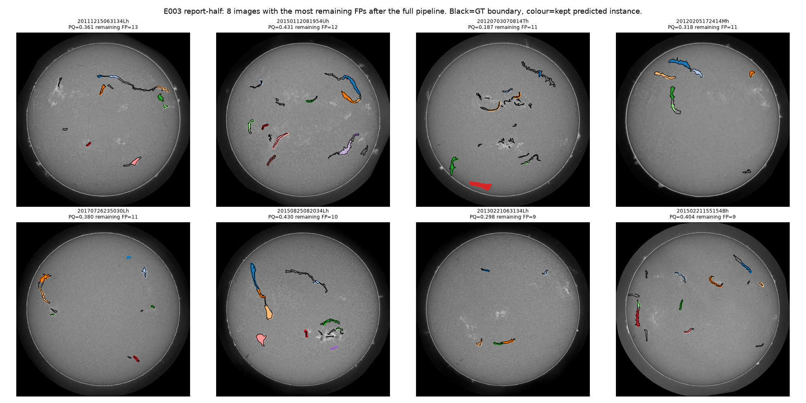

# FP + folds report — Spec 03

Covers `docs/specs/CODING_SPEC_03_FP_AND_FOLDS.md`. E003 (post-processing
only, local, fold-0 OOF probs from E002) is complete. E004 (5-fold Kaggle
training) is **prepared but not launched** — Nicky triggers the per-fold
Kaggle kernels; E005 (ensemble + refit on full OOF) depends on E004
finishing and hasn't started. Generated from `scripts/run_e003.py`,
`scripts/run_e003_gallery.py`, and `data/interim/E003_*`.

## Results table

All PQ/SQ/RQ numbers are on fold-0 val's **report** half (71 images), same
protocol as report 02: everything below is tuned on `tune` (71 images) and
scored once on `report`.

| Experiment | PQ | SQ | RQ | TP | FP | FN | Kaggle LB | Notes |
|---|---|---|---|---|---|---|---|---|
| Inter-annotator ref. | 0.3399 | 0.6337 | 0.5364 | 4292 | 3709 | 3709 | — | human ceiling, full train set |
| E002 (U-Net + CC, report 02) | 0.2691 | 0.6509 | 0.4134 | 486 | 1075 | 304 | 0.24 | t=0.7, closing_radius=2, min_area=418 |
| E003 step 1 (wider threshold grid) | 0.3019 | 0.6616 | 0.4563 | 496 | 888 | 294 | — | t=0.925, closing_radius=2, min_area=418 |
| E003 step 3 (+ shape gate) | 0.3199 | 0.6608 | 0.4841 | 488 | 738 | 302 | — | + elongation≥1.5 |
| E003 step 4 (+ learned scorer) | **0.3819** | 0.6665 | 0.5730 | 424 | 266 | 366 | not submitted | + keep iff P(match)·E[IoU] > 0.25 |

E003's final pipeline (step 4) is the same U-Net weights as E002, same
probability maps, zero additional training — **PQ 0.2691 → 0.3819 is
entirely a post-processing change.** RQ (0.573) exceeds the inter-annotator
RQ (0.5364), and overall PQ (0.3819) exceeds the inter-annotator PQ
(0.3399). That is a real, surprising result worth flagging rather than
quietly treating as "done": every threshold, the shape gate, and the
scorer's cutoff `c` were all fit/tuned on `tune` only and scored once,
unseen, on `report` (see "Is this overfit?" below), so it isn't an obvious
leakage artifact — but beating human-vs-human agreement on an
instance-matching metric is the kind of claim that deserves scrutiny before
it's taken as a ceiling-breaking result, not a one-line footnote.

`outputs/submissions/E003.csv` (1033 rows, 180 test images, 7 images with
zero predicted instances — allowed) was written and validates, but **has
not been submitted to Kaggle** — Nicky's call once this result is reviewed.

## Is this overfit to `tune`?

Three pieces of evidence against it being a tuning artifact:

1. **The grids aren't edge-pinned.** Step 1's best `t=0.925` sits inside
   the 0.50–0.95 grid, not at its boundary (report 02's old grid *was*
   pinned at `t=0.70`, which is exactly why this grid was widened). Step
   3's shape-gate heatmap and step 4's PQ-vs-`c` curve
   (`reports/figures/E003_shape_grid_heatmap.png`,
   `reports/figures/E003_pq_vs_c.png`) are both smooth and unimodal with
   the chosen value at the interior peak, not a spike at an edge.
2. **Tune and report move together, not apart.** Step 4's tune PQ is
   0.4009 vs report PQ 0.3819 — a normal ~2pt generalization gap, not a
   collapse, and in the same direction as every other step (tune
   consistently a few points above report, consistent with `tune` being
   used to pick the operating point).
3. **The FP-class breakdown (below) explains *why* PQ went up**, in a way
   that matches report 02's deep-dive hypothesis almost exactly: `isolated`
   FPs (confident-but-wrong detections on bright, non-filament structure —
   mostly plage/network) collapsed by 84% (807 → 126 across tune+report
   components), which is precisely the failure mode report 02 flagged as
   the single largest lever.

What this *doesn't* rule out: the report half is only 71 images, so a
report-level PQ this close to (or above) the human-ceiling PQ could still
partly be noise in a 71-image sample rather than a property that holds at
scale. The honest framing is "post-processing alone recovers most of the
PQ lost to isolated FPs, confirmed on a held-out half" — not "the model now
matches human performance" — and this should be re-checked against the
full 5-fold OOF in E005 before it's trusted as a stable number.

## FP class shares, before vs after, split by annotator count

Per Spec 03's caveat: on single-annotator images, an `isolated` FP can't be
told apart from a real filament the one annotator happened to skip, so its
count there is an upper bound on true false positives, not a clean
measurement. Counts are on the `report` half only (71 images), classified
with the same near_miss → annotator_disagreement → fragment → isolated
priority order as report 02's deep-dive.

| | single-annotator: before | single-annotator: after | multi-annotator: before | multi-annotator: after |
|---|---|---|---|---|
| isolated | 266 | 60 | 541 | 66 |
| near_miss | 55 | 22 | 128 | 72 |
| annotator_disagreement | — | — | 74 | 42 |
| fragment | 7 | 3 | 4 | 1 |
| **total FP** | **328** | **85** | **747** | **181** |

(Before = E002's tuned postprocess fresh-applied to the same OOF probs;
after = E003's full step1+step3+step4 pipeline. Totals match the top-level
FP counts above: 328+747=1075 before, 85+181=266 after.)

`isolated` dropped 84% overall (807 → 126) — the single largest share of
the FP reduction — but it's not the *only* thing that improved:
`near_miss` also roughly halved on both subsets (55→22, 128→72), and
`annotator_disagreement` nearly halved on multi-annotator images (74→42).
The shape gate and scorer aren't just a precision filter for one failure
mode; they generically suppress low-quality / borderline components. The
single-annotator `isolated` count (266→60) carries the stated caveat most
directly — some real, single-annotator-only filaments may have been
discarded along with true FPs — but the multi-annotator `isolated` count
(541→66, unambiguous true FPs) accounts for most of the raw-count drop, so
the caveat doesn't explain away the result.

## Component scorer: feature importances

Fit on `tune` components only (3139 total extracted across tune+report,
24% true-positive rate on each split — consistent, no tune/report drift in
what a "component" looks like). Logistic regression gives standardized
`|coef|`; the HistGradientBoostingClassifier (no built-in importances) uses
permutation importance on ROC AUC, 10 repeats.

| feature | logistic \|coef\| | HGB permutation importance |
|---|---|---|
| prob_mean | 5.22 | 0.145 |
| area | 0.46 | 0.058 |
| r_over_R | 0.46 | 0.043 |
| orientation | 0.03 | 0.021 |
| length | 0.36 | 0.013 |
| max_width | 0.51 | 0.010 |
| elongation | 0.87 | 0.007 |
| texture_std | 0.12 | 0.007 |
| local_intensity | 0.04 | 0.006 |
| ring_intensity | 0.02 | 0.005 |
| frac_bright_nearby | 0.24 | 0.004 |
| mean_width | 0.37 | 0.003 |
| solidity | 0.42 | 0.003 |
| contrast | 0.01 | 0.001 |
| prob_max | 0.01 | 0.000 |
| prob_p90 | 0.27 | 0.000 |

`prob_mean` dominates by a wide margin — unsurprising, since the raw
network confidence already carries most of the signal the scorer exploits,
and matches report 02's finding that isolated FPs were *confident*
(median prob 0.957), not low-confidence noise the scorer could catch for
free. Restricting to the two hand-engineered groups the spec asks to
compare: mean HGB importance of the shape features (area, length,
elongation, max/mean width, solidity, orientation) is 0.0166 vs 0.0046 for
the context features (local/ring intensity, contrast, texture_std,
frac_bright_nearby) — **shape beats context**, by roughly 3.6x. The plage/
network brightness signal the context features were built to capture
(report 02's hypothesis for why isolated FPs cluster near bright regions)
turns out to be a weaker discriminator than simply "is this component
compact/blob-shaped or elongated/thread-like" — which the shape gate
(step 3) already captures cheaply without any model. Position (`r_over_R`)
is a solid secondary signal, plausibly tracking limb artifacts.

## Remaining worst FPs (gallery)

The 8 report-half images with the most residual FPs after the full
pipeline (`reports/figures/E003_gallery.png`, black = GT boundary, colour =
kept predicted instance). Two things stand out:

- Per-image PQ on these "worst" images (0.19–0.43) is far from catastrophic
  — nothing like report 02's worst images, several of which scored 0. Most
  predicted instances visibly line up with a GT filament; the elongated
  thread shapes are mostly correct.
- The visible remaining errors are almost all **compact, blob-shaped
  regions** (e.g. the solid pink/red patches in several panels) rather than
  thin filament-like FPs — components that passed the elongation≥1.5 gate
  (not a strict filter) and still scored above the learned cutoff. This is
  a concrete, visually confirmed residual failure mode for Spec 04 to
  target directly (see hypotheses below), rather than "more of the same
  isolated-FP problem."

## E004 / E005 — not run this session

E004 (5-fold Kaggle training, EMA + PQ-based checkpoint selection, 4000
iterations/fold) is fully prepared but **not launched**:

- `configs/E004-f0.yaml` … `E004-f4.yaml` — one per fold, verified to parse
  and differ only in `experiment_id`/`fold`.
- `notebooks/e004_f0/` … `e004_f4/` — one Kaggle notebook + kernel-metadata
  pair per fold (`kaggle kernels push -p notebooks/e004_fN` to launch fold
  N; this was deliberately not run by Claude since it starts a GPU job
  immediately).
- `outputs/kaggle_pkg` pushed as a new version of the
  `potcharapanchumrak/solar-k-package` Kaggle dataset, so the notebooks have
  everything they need (components.py, scorer.py, the EMA/PQ-checkpoint
  train.py, the 5 configs) the moment they're pushed.
- EMA + PQ-based checkpoint selection verified end-to-end on a 50-iteration
  Mac smoke test (`configs/E004_smoke.yaml`): train, resume (EMA state
  round-trips), checkpoint saved/loaded with EMA shadow intact.

**Per-fold PQ for E004 and E005: pending** — these sections of this report
can't be filled until Nicky launches the 5 Kaggle kernels and they finish
(4000 iterations each; E002's 6000-iteration run took the Kaggle kernel
roughly 5-6h end to end, so expect something in that range per fold,
possibly less given fewer iterations). Once all 5 OOF prob sets exist,
E005 (ensemble test probs, refit the scorer with grouped 5-fold CV, report
mean±std PQ as the new headline number) is the next spec item and isn't
started.

## Ranked hypotheses for Spec 04

1. **Compact/blob-shaped FPs are now the dominant residual error** (see
   gallery). The shape gate uses elongation as a soft threshold with a
   learned scorer on top, not a hard reject — a stricter elongation floor,
   or a feature that explicitly distinguishes "blob" from "thread" (e.g.
   a convexity/circularity feature, not currently in `components.py`),
   is the most direct, cheapest next step and doesn't require retraining.
2. **E005's refit-scorer-on-ensemble-probs mismatch, flagged in the spec,
   needs checking before it's trusted.** The scorer was fit on a
   single-model's OOF probabilities; applying it to a smoother 5-model
   ensemble's test probabilities could shift the probability-feature
   distributions the scorer (and its top feature, `prob_mean`) relies on
   most heavily. Worth an explicit before/after comparison of the
   `prob_mean` distribution on OOF vs ensemble-test once E004 lands.
3. **PQ-based checkpoint selection (E004) should meaningfully help**, since
   report 02 found E002's pixel-Dice-selected checkpoint was picked at
   iteration 2000/6000 while Dice kept degrading after — a checkpoint
   metric that's closer to the actual competition metric should reduce
   that mismatch, independent of anything else in this report.
4. **Context features underperformed their hypothesis.** Report 02's
   theory (isolated FPs cluster on bright plage/network regions) is
   directionally true but a weak discriminator relative to shape — not
   worth more investment unless a specific new context feature (e.g.
   distance to nearest sunspot/plage region from a dedicated detector,
   rather than a local brightness ring) is proposed.
5. **5-fold OOF (post-E004) is the right place to get a reliable PQ
   estimate** — this report's headline 0.3819 is a single 71-image report
   half; Spec 04 prioritization should use E005's mean±std across folds,
   not this number, once available.

## Reproducibility / acceptance

- `pytest -q`: **79 passed** (includes new `tests/test_components.py`,
  `tests/test_scorer.py`, and EMA-specific additions to
  `tests/test_checkpoint.py`).
- No parameter or scorer was fit on the data it was scored on: step 1's
  grid, step 3's shape gate, and step 4's scorer + cutoff `c` were all
  selected on `tune` and scored once on `report`; the final test-set
  submission's scorer was refit on tune+report combined (documented in
  `scripts/run_e003.py`) since the test set has no held-out scoring split
  left to protect.
- `outputs/submissions/E003.csv` validates via `scripts/validate_submission.py`.
- `pixel_iou_dice` is now wired into `evaluate.aggregate_evaluation`
  (`pixel_dice_mean` column above) — closes report 02's acceptance gap.
- Report 02's acceptance note has been corrected: both E001 and E002 were
  submitted to Kaggle (0.03 / 0.24 public scores, now recorded in
  `experiments.csv` and `reports/02_baseline_report.md`).
